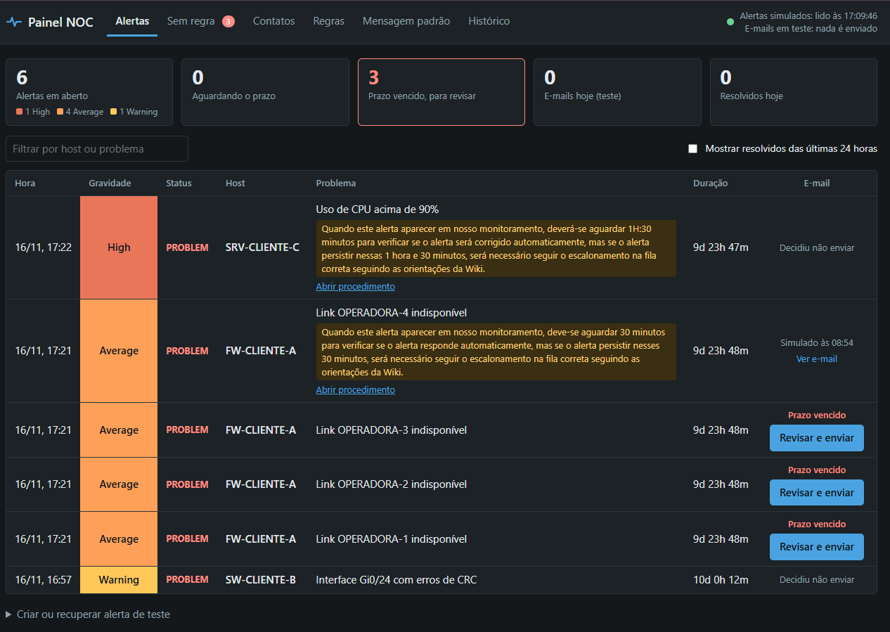
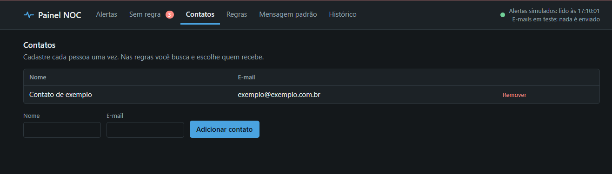
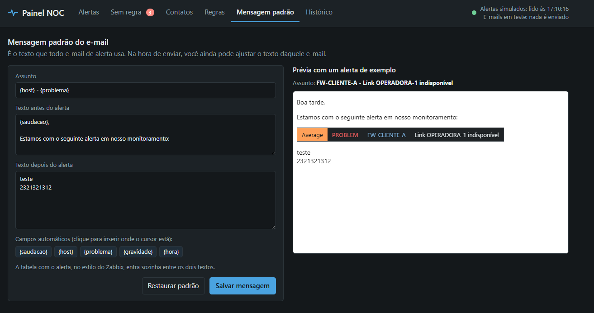
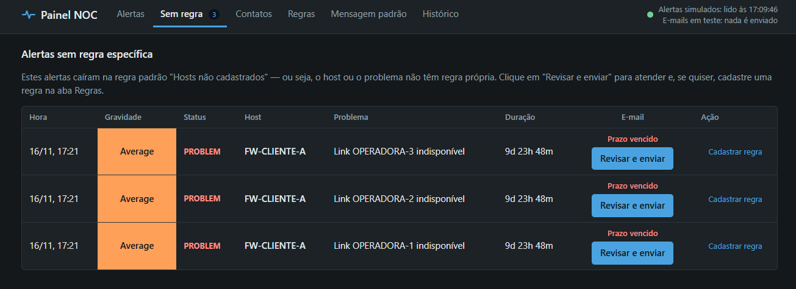
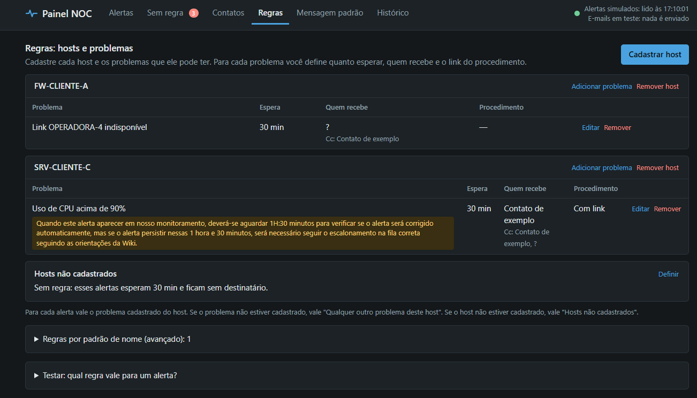
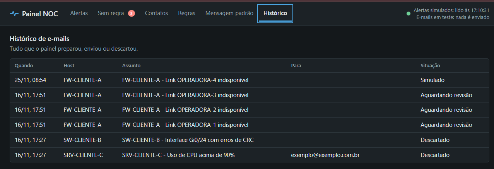

# Painel NOC

Painel web de alertas Zabbix desenvolvido em Python (FastAPI) + Docker para equipes de NOC e SRE.  
Lê os problemas abertos do Zabbix, agrupa por host em incidentes, controla o prazo de cada regra de escalonamento e prepara o rascunho do e-mail padrão com a mensagem da equipe — pronto para revisão e envio direto da interface.

## Pré-visualização

Prints reais da interface (modo simulado):

### Lista de alertas

Fila principal com contadores por gravidade, prazos vencidos com botão **Revisar e enviar** e filtro por host/problema.



### Sem regra

Alertas de hosts ou problemas ainda não cadastrados, caindo na regra padrão — dá pra atender e cadastrar a regra direto dali.



### Regras

Cadastro de regras por host e problema: tempo de espera, destinatários (Para/Cc) e link do procedimento na wiki.



### Contatos

Destinatários cadastrados uma vez e reutilizados nas regras.



### Mensagem padrão

Modelo do e-mail de alerta com variáveis automáticas (`{saudacao}`, `{host}`, `{problema}`, `{gravidade}`, `{hora}`) e prévia com um alerta de exemplo — o print no estilo do Zabbix entra sozinho entre os dois textos.



### Histórico

Registro dos e-mails preparados/simulados e das decisões tomadas em cada alerta.



---

## Funcionalidades

- **Leitura automática do Zabbix**: sincroniza problemas abertos em ciclo contínuo (modo real ou simulado).
- **Agrupamento por incidente**: cada problema vira um alerta separado com prazo e e-mail próprios.
- **Regras de escalonamento**: cadastre regras por host e problema, com tempo de espera, destinatários, cópia e envio automático.
- **Mensagem padrão configurável**: edite assunto, texto antes e texto depois do alerta, com variáveis automáticas (`{saudacao}`, `{host}`, `{problema}`, `{gravidade}`, `{hora}`).
- **Revisão e envio de e-mails**: abra o rascunho, edite se precisar e envie (ou simule) direto da tela.
- **Tela "Sem regra"**: liste alertas de hosts ou problemas ainda não cadastrados e cadastre regras diretamente por lá.
- **Modo simulado**: teste todo o fluxo sem enviar e-mail de verdade.
- **Docker Compose**: suba tudo com um comando, sem instalar dependências manualmente.
- **Testes automatizados**: cobertura do motor de regras com `unittest`.

## Pré-requisitos

- [Docker](https://www.docker.com/) e Docker Compose, ou
- Python 3.10+ (para rodar sem Docker)

## Rodar com Docker (recomendado)

```bash
# 1. Acesse a pasta do projeto
cd C:\Projetos\Painel-NOC\noc-painel

# 2. Copie o arquivo de configuração de exemplo
copy .env.example .env

# 3. Edite o .env com pelo menos PAINEL_USUARIO e PAINEL_SENHA

# 4. Suba o serviço
docker compose up -d --build

# 5. Abra no navegador
http://localhost:8080
```

Comandos úteis:
- `docker compose logs -f` — acompanhar logs em tempo real
- `docker compose down` — parar os serviços
- `docker compose up -d --build` — aplicar mudanças no código

## Rodar sem Docker (somente Windows)

```powershell
# Dentro da pasta backend
cd backend

# Criar ambiente virtual e instalar dependências
python -m venv .venv
.\.venv\Scripts\python -m pip install -r requirements.txt

# Subir o painel (modo real, com token do Zabbix)
.\.venv\Scripts\python iniciar.py

# Modo simulado (sem Zabbix, sem envio de e-mail real)
.\.venv\Scripts\python iniciar.py --simulado
```

## Configuração (.env)

Copie `.env.example` para `.env` e ajuste:

| Variável | Descrição |
|----------|-----------|
| `PAINEL_USUARIO` | Usuário de login do painel |
| `PAINEL_SENHA` | Senha de login do painel |
| `ZABBIX_MODE` | `mock` (simulado) ou `real` |
| `ZABBIX_URL` | URL do Zabbix API (termina em `/api_jsonrpc.php`) |
| `ZABBIX_TOKEN` | Token de API do Zabbix (usuário somente leitura) |
| `EMAIL_MODE` | `dry-run` (simulado) ou `smtp` (envio real) |
| `SMTP_*` | Credenciais SMTP da conta do NOC (só em modo smtp) |

## Licença

Este projeto está sob a licença [MIT](LICENSE). Você pode usar, modificar e distribuir livremente, mantendo os avisos de autoria.

## Autor

Jefferson Souza
<h4 align="center"> 
    :construction:  Projeto em construção  :construction:
</h4>
